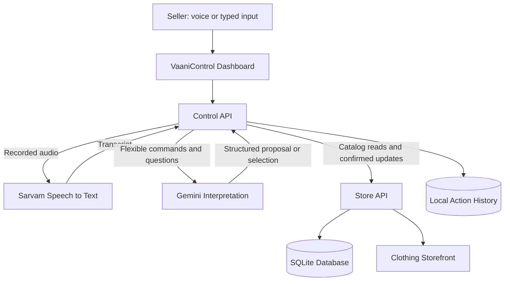

# VaaniControl 🎙️
### Your voice. Your store.

**Multilingual voice administration for an independent online clothing store.**

VaaniControl helps sellers manage product prices and inventory using English or Telugu commands. Every proposed change is shown for review before execution, with action history and conditional Undo.

Developed by **TEAM VAANI — Chennai Institute of Technology**.

[Explore the integrated project](https://github.com/Chinnampavansai2008/Vaani-Control/tree/feature/vaanicontrol-fresh) · [View the integration pull request](https://github.com/Chinnampavansai2008/Vaani-Control/pull/2)

---

## The Problem

Online sellers repeatedly navigate administration screens to update prices, adjust stock and check product information. These routine tasks can become harder when interfaces use unfamiliar language or require several navigation steps.

VaaniControl explores a simpler approach:

> **Speak the task. Review the details. Confirm the change. Stay in control.**

The project connects a voice dashboard to a separate clothing storefront through an explicit backend API.

## How It Works

1. **Speak or type** a command in English or Telugu.
2. **Review and edit** the transcript.
3. Select **Preview** to inspect the product, current value and proposed value.
4. Select **Confirm** to apply the change.
5. Check the storefront and action history.
6. Use **Undo** to restore the previous value when no conflicting update has occurred.

**Recording, transcription and Preview do not change the store. An update requires explicit confirmation.**

## Implemented Features

| Feature | What it does |
|---|---|
| English and Telugu input | Supports regional-language interaction and editable transcripts |
| Browser speech recognition | Captures commands through supported browsers |
| Sarvam transcription | Converts recorded audio into editable text |
| Gemini interpretation | Interprets flexible commands into structured proposals |
| Exact-command parser | Handles supported command patterns without a Gemini key |
| Price and stock updates | Updates one product’s price or stock at a time |
| Percentage price changes | Calculates increases or reductions with whole-rupee rounding |
| Preview and Confirm | Shows proposed changes before applying them |
| Conflict protection | Checks expected values before applying or reversing an update |
| Action history and Undo | Records applied changes and supports conditional reversal |
| Ask store | Reads a product’s current price or stock without modifying it |
| Read aloud | Uses available browser voices for supported answers and previews |
| History search and filters | Filters actions by product, field and status |
| CSV export | Downloads the displayed history results |
| Connected Store panel | Checks catalog reachability and compatibility |
| Clothing storefront | Provides product browsing, options, shopping bag and demo checkout |
| Checkout consistency | Refreshes bag prices and rejects stale submitted prices before order writes |
| Startup launcher | Checks dependencies, ports, configuration and database compatibility |

### Example Commands

Use product names from the current catalog.

| Command | Action |
|---|---|
| `Change black hoodie price to 899` | Preview an exact price update |
| `Make the black hoodie cost 999 rupees` | Interpret a flexible price command |
| `Reduce Black Hoodie price by 10 percent` | Calculate a percentage price reduction |
| `వైట్ టీ షర్ట్ స్టాక్ 30కి మార్చు` | Request a stock update in Telugu |
| `What is the Black Hoodie price?` | Read the current price using **Ask store** |

Select **Preview** for update commands and **Ask store** for questions. Review recognized product names and values before confirming.

## Architecture



The model proposes an interpretation; the backend validates it against the catalog.

For **Ask store**, the model selects the product and field. The answer comes from the actual catalog, rather than a model-generated price or stock value.

The controller communicates through the store API and does not write directly to the store database.

## Technology Stack

| Component | Technologies |
|---|---|
| Voice dashboard | React, JavaScript, Vite |
| Clothing storefront | React, TypeScript, Vite |
| Backend services | Python, FastAPI |
| Store persistence | SQLite |
| Flexible command interpretation | Google Gemini through `google-genai` |
| Recorded speech transcription | Sarvam AI |
| Browser speech | Speech recognition and speech synthesis APIs |
| Automated verification | pytest, unittest and Node.js tests |

## Repository Structure

```text
Vaani-Control/
├── control-api/       # Interpretation, transcription, preview and execution
├── control-web/       # Voice dashboard, review, history and recovery
├── store-api/         # Catalog, inventory, orders and store integration
├── store-web/         # Customer storefront and seller tools
├── tests/            # Store and launcher tests
├── run_dev.py        # Starts and supervises the four local services
├── .gitignore
└── README.md
```

## Run Locally

### 1. Prerequisites

- Python **3.10 or newer**
- Git and npm
- Node.js compatible with Vite 7: **20.19+, 22.12+, or a newer supported LTS release**
- A supported browser with microphone permission for voice demonstrations

Chrome or Edge is recommended for the microphone demonstration. Speech recognition and playback depend on browser support and available system voices.

### 2. Clone the Integrated Branch

```powershell
git clone --branch feature/vaanicontrol-fresh --single-branch https://github.com/Chinnampavansai2008/Vaani-Control.git VaaniControl
cd VaaniControl
```

Run the remaining commands from this repository root.

### 3. Install Dependencies

An isolated Python environment is recommended.

```powershell
python -m pip install -r store-api/requirements.txt -r control-api/requirements.txt
npm --prefix store-web ci
npm --prefix control-web ci
```

### 4. Configure Environment Files

Keep real credentials in local `.env` files. **Never commit actual API keys or place them in `.env.example` or frontend code.**

For a fresh clone, the following PowerShell command copies templates only when the destination file does not already exist:

```powershell
foreach ($folder in @('control-api', 'store-api', 'store-web')) {
    $envFile = Join-Path $folder '.env'
    if (-not (Test-Path -LiteralPath $envFile)) {
        Copy-Item -LiteralPath (Join-Path $folder '.env.example') -Destination $envFile
    }
}
```

Configure the files locally:

| File | Required configuration |
|---|---|
| `control-api/.env` | `GEMINI_API_KEY` for flexible commands and Ask store; `SARVAM_API_KEY` for Sarvam transcription |
| `control-api/.env` | `STORE_API_URL=http://127.0.0.1:8001` and a `STORE_API_KEY` matching the store backend |
| `store-api/.env` | Matching `STORE_API_KEY` and a separate `STORE_ADMIN_KEY` for seller administration |
| `store-web/.env` | `VITE_STORE_API_URL=http://127.0.0.1:8001` |

Leave `GEMINI_MODEL` blank for discovery of an advertised Flash model, or set an exact model ID available to your account.

The templates use `local-demo-key` and `local-admin-key` as **public local-demo values**. These are separate from private Gemini and Sarvam credentials and are unsuitable for production deployment.

Exact typed commands work without cloud keys. Flexible interpretation and Ask store require Gemini. Sarvam recording requires a Sarvam key. Browser recognition may itself use an online service, so the complete application is not offline-capable.

### 5. Check the Setup

Stop earlier project instances from their own terminals using **Ctrl+C**, then run:

```powershell
python run_dev.py --check
```

Proceed only when preflight passes.

### 6. Start the Project

```powershell
python run_dev.py
```

Wait for the **Ready** message.

| Service | Address |
|---|---|
| VaaniControl dashboard | http://127.0.0.1:5174/ |
| Clothing storefront | http://127.0.0.1:5173/ |
| Control API documentation | http://127.0.0.1:8002/docs |
| Store API documentation | http://127.0.0.1:8001/docs |

Keep the launcher terminal open. Press **Ctrl+C in that terminal** to stop its services.

Run only one launcher instance. It checks ports `8001`, `8002`, `5173` and `5174` and does not terminate existing port owners.

### Database Compatibility

A fresh database is created and seeded during initial startup.

Do not replace it with an older starter database: older schemas may be incompatible. The launcher checks existing schemas without modifying them.

To select a separate fresh demo database, set `STORE_DB_PATH=integration-demo.db` in `store-api/.env`. Relative paths resolve from `store-api/`. Selecting another database does not migrate existing data.

## Suggested Demo Walkthrough

1. Open the storefront and VaaniControl side by side.
2. Check the Connected Store panel.
3. Speak an English price command and review its transcript.
4. Select Preview and show that the storefront remains unchanged.
5. Confirm the action and show the updated product and shopping-bag price.
6. Undo the action and show the original value restored.
7. Demonstrate a Telugu stock command and a percentage price change.
8. Use Ask store to retrieve a current catalog value.
9. Demonstrate history search, filters and CSV export.
10. Complete a demo checkout and show inventory deduction.

Checkout is a demonstration and collects **no real payment**.

## Verification

Recorded results at the reviewed integration checkpoint **`770614c`**:

| Check | Result |
|---|---|
| Backend automated tests | **94 passed** |
| Frontend automated tests | **58 passed** |
| Production builds | **Both passed** |
| Manual integrated checks | Bag-price refresh, Undo, demo checkout and inventory deduction passed |

The frontend total includes **51 dashboard/helper tests** and **7 shopping-bag pricing tests**.

English/Telugu speech and provider flows were also manually checked during development. Automated provider tests use mocks where appropriate. These results are not measurements of speech-recognition accuracy, user-study outcomes, load capacity or production readiness.

Run the automated checks:

```powershell
python -m pytest -q tests control-api
npm --prefix store-web test
npm --prefix control-web test
npm --prefix store-web run build
npm --prefix control-web run build
```

Use the launcher to inspect the working application rather than opening a built `dist/index.html` directly from the filesystem.

## Main API Routes

| Service | Route | Purpose |
|---|---|---|
| Control | `GET /api/store/status` | Check catalog connectivity and compatibility |
| Control | `POST /api/transcribe` | Return a transcript from recorded audio |
| Control | `POST /api/preview` | Validate a proposal and create a pending action |
| Control | `POST /api/confirm/{id}` | Apply an approved action |
| Control | `GET /api/history` | Retrieve action history |
| Control | `POST /api/undo/{id}` | Attempt a conditional reversal |
| Control | `POST /api/query` | Read a product’s current price or stock |
| Store | `GET /api/products` | Retrieve the catalog |
| Store | `PATCH /api/integrations/products/{id}` | Apply an authenticated conditional update |
| Store | `POST /api/orders` | Validate and create a demo order |

See the running APIs’ `/docs` pages for request schemas.

## Reliability and Privacy

- **Explicit approval:** a transcript or model proposal cannot directly authorize an update.
- **Conflict checks:** Confirm and Undo verify expected current values.
- **Checkout validation:** the current storefront submits expected unit prices. The backend validates prices, stock and options in a SQLite transaction before creating the order and deducting stock.
- **Customer review:** stale checkout prices return a conflict; the frontend does not silently retry.
- **Backend credentials:** private provider keys remain on the backend.
- **Audio limits:** Sarvam recording is limited to 30 seconds in the UI and 5 MiB per upload.
- **External processing:** audio is sent to Sarvam; flexible command text and catalog context are sent to Gemini. Browser speech may use a browser-provider service.
- **Cancellation:** microphone resources are released and late UI results are discarded. An upload already submitted may still be processed by the provider.

## Current Limitations

This is a **local, single-store hackathon prototype**.

- Updates target one product at a time.
- Stock is tracked per product, not independently for each size or color.
- Pending previews are held in memory.
- Controller history and the store database are separate persistence boundaries.
- Durable cross-service recovery and reconciliation require further work.
- Provider availability, credits, permissions and browser capabilities affect voice features.
- Telugu playback requires an available Telugu system voice.
- Full user authentication, role-based access, real payments and production deployment hardening are not implemented.
- Existing clients can omit expected checkout prices for compatibility; the current storefront supplies them.

## Intended Impact

VaaniControl aims to make routine store administration more accessible to sellers who prefer voice or regional-language interaction.

Its central design combines:

- Familiar-language input
- Editable transcripts
- Visible proposed changes
- Deliberate approval
- Store verification and recovery

A pilot with real sellers is needed to measure task completion time, correction rates, accessibility and usefulness. No measured business improvement or recognition-accuracy percentage is claimed.

## Future Roadmap

These features are **planned or proposed and are not part of the completed prototype**.

| Future feature | Intended benefit |
|---|---|
| Low-stock alerts | Help sellers notice inventory shortages |
| Relative stock adjustments | Support commands such as adding newly received stock |
| Voice confirmation with safeguards | Reduce interaction steps while preserving explicit approval |
| Multi-product campaigns | Review and apply larger changes with per-item outcomes |
| WooCommerce and other adapters | Connect the interaction layer to additional platforms |
| More languages and accessibility evaluation | Broaden access and validate usability |
| Durable action records and reconciliation | Improve recovery after service failures or restarts |
| Authentication and role-based permissions | Support controlled pilots beyond a local demonstration |
| Multi-store support | Manage more than one connected store |
| Offline strategy | Explore reduced-connectivity operation through additional architectural work |

## Team

### TEAM VAANI
**Chennai Institute of Technology**

| Role | Name |
|---|---|
| Team Leader | **CHINNAM PAVAN SAI** |
| Team Member | LOKIREDDY AMRUTHA REDDY |
| Team Member | Kundivakam Greeshma |
| Team Member | Mutyala Saathvi Reddy Sridha Reddy |
| Team Member | Burla Jaideep Reddy |

---

**VaaniControl — Speak a change. Review the details. Stay in control.**
